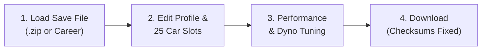

# 🏎️ Need for Speed: Underground 2 Career Save Editor

### Extended 25 Car Slots Edition &bull; Full Dyno &bull; Electric Purple HUD

<p align="center">
  
  
  
  
  
</p>

<p align="center">
  <strong>A modern, zero-dependency browser-based save game editor for Need for Speed: Underground 2.</strong><br>
  Runs 100% locally in your browser. Features extended 25-car garage support, real-time dyno curve manipulation, gear ratio tuning, career stage gating, and automatic checksum recalculation.
</p>

---

## ✨ Features & Capabilities

### 🚗 1. Extended Garage — 25 Car Slots Architecture
* **Up to 25 Car Slots**: Expand far beyond the vanilla 5-car limit to store, configure, and race your entire dream fleet.
* **`GARAGE.DAT` Version 2 (40,712 bytes)**: Full native support for extended garage files with 20 supplementary car records (slots 6–25) alongside the 5 career slots.
* **1-Click 25-Slot Expansion**: Automatically upgrades standard 5-slot and 10-slot saves to 25 slots with verified `CAREER_SLOT_<n>` hash tables.
* **Slot Swapping (Experimental)**: Safely swap vehicles between any of the 25 slots while preserving internal record handles.
* **Car Replacement & Injection**: Replace any slot with stock donor vehicles, regional specials, or experimental traffic models.
* **Individual Slot State Control**: Toggle slot locks, sponsor car vacancies, and bought flags independently.

### ⚡ 2. Performance Tuning & Dyno Suite
* **9 Performance Categories**: Weight Reduction, Transmission, Nitrous, Engine, Turbo, Suspension, Brakes, ECU, and Tires.
* **Unique Performance Parts**: Full support for all 9 rare unique part upgrades and inventory ownership flags.
* **1-Click "MAX OUT"**: Instantly install top-tier parts and all unique upgrades across all categories in a single click.
* **Interactive Dyno Graphs**: Drag-and-drop RPM torque and power curve editing for both ECU and Turbo.
* **Drivetrain & Gear Ratio Tuning**: Real-time gearing simulation with customizable gear ratios and final drive.
* **Auto-Tune Optimization**: Optimize dyno curves and gear ratios targeted at specific event strategies (*Acceleration, Top Speed, Drag, Drift, Sprint, Circuit*).
* **Creator's Unlock Table**: Toggle complete part unlocks per slot to unleash restricted customization.

### 💰 3. Profile & Career Progression Control
* **Money & Bankroll**: Edit career cash up to the 32-bit maximum of **\$2,147,483,647**.
* **Driver Name**: Change driver alias with full Latin-1 support (up to 31 characters).
* **Career Stage Selector**: Adjust career stage from Stage 0 (Intro) through Stage 6 (Post-Career).
* **Safe Shop Discovery**: Reveal and unlock eligible shops across the map without breaking progression triggers.
* **100% Career Completion**: Mark all BUN career goals and photo events complete cleanly with proper event flags.

### 🛡️ 4. Automatic Checksum & Fingerprint Correction
* **Three-Point CRC Recalculation**: Recalculates Block A, Block B, and Container Header CRCs on export so modified saves never report corruption.
* **FNV-1a 64-bit Fingerprinting**: Recalculates matching 64-bit fingerprints between career saves and paired `GARAGE.DAT` files.
* **Safe In-Memory Architecture**: Files are processed using non-destructive Uint8Array slicing.

### 🟣 5. Electric Purple Racing HUD Theme
* Modern neon purple aesthetics (`#b388ff` / `#cbb0ff`) inspired by authentic street-racing underglow and dashboard telemetry.
* Responsive, high-contrast dark theme optimized for both desktop and mobile screens.

### 🔒 6. 100% Client-Side & Privacy-First
* Everything executes strictly inside your browser's JavaScript engine.
* No server uploads, no cookies, no tracking, and zero external backend requirements.

---

## 🚀 Quick Start



### Option A: Local Server Launcher (Recommended)
1. Double-click **`start.bat`**.
2. A lightweight local server starts automatically and opens `http://localhost:8080/` in your default browser.

### Option B: Direct Offline File Open
1. Simply double-click **`index.html`** in File Explorer.
2. The bundled application runs immediately with full offline Angular and zero CORS restrictions.

---

## 📖 How to Edit Your Save

1. **Load Save**:
   * Click **Choose File** under **Save file**.
   * Select your career save (e.g., `MisterG`) or an `nfsu2-web` backup `.zip`.
2. **Configure Profile & Slots**:
   * Modify your Driver Name or Cash balance.
   * Browse through **Car Slots 1 to 25**.
   * If your save only has 5 slots, click **"+ Expand to 25 car slots"** to activate slots 6–25.
3. **Tune & Customize**:
   * Click **Tuning…** on any filled slot to install parts or click **MAX OUT**.
   * Switch to the **DYNO** tab to customize torque curves and gear ratios.
4. **Export**:
   * Click **Download edited save** or **Download edited ZIP**.
   * Place the downloaded files into your game's save folder and hit the streets!

---

## 📂 Project Structure

```text
Editor/
├── index.html            # Main web interface entry point
├── bundle.js             # Self-contained bundled application logic
├── angular.min.js        # Offline AngularJS framework
├── app.css               # Electric Purple HUD stylesheet
├── editor.css            # Base UI component styles
├── car-donors.json       # Stock vehicle donor blocks
├── server.js             # Lightweight Node.js local server
├── start.bat             # 1-click launcher script
├── publish-github.bat    # 1-click GitHub Pages publisher
├── src/                  # Full TypeScript source code
│   ├── model/            # Save binary layout, 25-slot garage, dyno, & checksums
│   ├── controller/       # UI state management & event controllers
│   └── data/             # Performance part tables & traffic definitions
└── dist/                 # Production-ready static build
```

---

## 📜 License & Disclaimers

* Distributed under the **MIT License**.
* *Need for Speed, Need for Speed: Underground 2*, and all associated vehicle trademarks are the intellectual property of Electronic Arts Inc. This software is an independent, non-commercial fan-made project.
